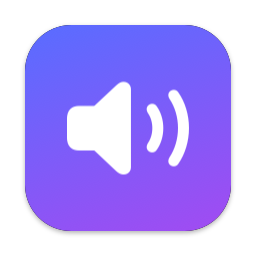

<p align="center">
  
</p>

<h1 align="center">SoundRoute</h1>

<p align="center">
  Keep your Mac on the speaker and microphone <em>you</em> want.<br>
  A tiny, native menu bar app for macOS.
</p>

<p align="center">
  
  
  
</p>

---

## Why

Connect AirPods, a monitor, a dock or a USB interface and macOS happily moves your audio
to it — often not what you want. Worse, using AirPods as a microphone drops their sound
quality to “phone call” mode.

SoundRoute lets you rank your output and input devices. Whenever a device connects,
disconnects, or macOS changes the default on its own, SoundRoute switches back to the
highest-ranked device that is available.

## Features

- **Two priority lists** — one for output, one for input — reordered by dragging
- **Remembers devices** while they're unplugged; new devices are added at the bottom
- **Per-device switch** to never auto-select a device (e.g. AirPods for listening, but never their mic)
- **Per-direction auto-switching** you can pause from the menu bar
- **Pick from the menu** to use a device right away and make it top priority
- **Alert sounds follow** the output device (optional)
- **Open at login**
- **Native** SwiftUI menu and Settings window that adopt the current macOS look automatically

## Privacy

SoundRoute has no network code, no analytics, no third-party dependencies and asks for no
permissions. It only talks to Apple's CoreAudio to read and set the default devices.
Preferences are stored locally in `~/Library/Preferences/io.github.gandalfoglia.SoundRoute.plist`.

## Install

There are no prebuilt binaries — build it yourself in a few seconds so you know exactly what
you're running. Requires macOS 15 or later and Xcode or the Command Line Tools
(`xcode-select --install`).

```bash
git clone https://github.com/gandalfoglia/sound-route.git
cd sound-route
./Scripts/build-app.sh --install
```

This builds a release binary, wraps it in `SoundRoute.app`, signs it ad-hoc for your machine,
copies it to `/Applications` and launches it. Without `--install` the app is left in `dist/`.

## Usage

1. Click the speaker icon in the menu bar.
2. Choose a device to use it now — it also becomes your top priority.
3. Open **Settings…** (<kbd>⌘</kbd><kbd>,</kbd>) and drag devices into your preferred order on the
   **Output** and **Input** tabs. Right-click a disconnected device to forget it.

The icon is filled while auto-switching is on and outlined when it's paused.

## How it works

SoundRoute registers CoreAudio property listeners for the device list and the default
input/output devices. After a change it waits briefly (macOS often switches in several
steps, especially with Bluetooth), then picks the first enabled, connected device from
your list and makes it the default if it isn't already.

| File | Purpose |
| --- | --- |
| [`AudioSystem.swift`](Sources/SoundRoute/AudioSystem.swift) | CoreAudio: list devices, read/set defaults, change listeners |
| [`Preferences.swift`](Sources/SoundRoute/Preferences.swift) | Priority lists and options, stored as JSON in UserDefaults |
| [`RouteController.swift`](Sources/SoundRoute/RouteController.swift) | Watches for changes and enforces your priority order |
| [`MenuContent.swift`](Sources/SoundRoute/MenuContent.swift) | Menu bar menu |
| [`SettingsView.swift`](Sources/SoundRoute/SettingsView.swift) | Settings window |
| [`Scripts/build-app.sh`](Scripts/build-app.sh) | Builds and bundles the `.app` |
| [`Scripts/make-icon.swift`](Scripts/make-icon.swift) | Renders the app icon from code |

## Development

```bash
swift build                    # debug build
swift run                      # run without bundling (some features, like Open at login, need the .app)
swift Scripts/make-icon.swift  # regenerate the icon
```

## License

[MIT](LICENSE)
